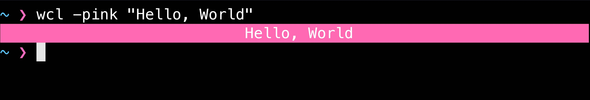
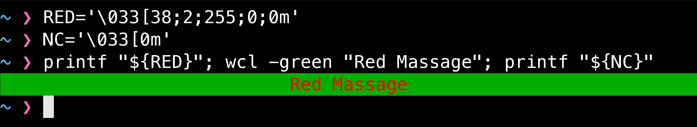

# 🎨 Wall Color Tool (WCL)

`wcl` 是一個用 Bash 撰寫的小工具，能夠在終端機中輸出「置中」顯示、帶有背景色的文字。

## 使用方式

### 基本用法

```bash
wcl -[顏色] "你的文字"
```

- 範例

```bash
wcl -pink "Hello World!"
wcl -red "WARNING: Something is wrong."
```



### 進階用法

若你希望自訂`字體顏色`或`加粗文字`，可搭配 `printf` 和定義好的顔色變數使用，前提是你需要定義好顔色變數  
我知道這太複雜了，後期會新增加快速的寫法的

- 範例

```bash
RED='\033[38;2;255;0;0m'
NC='\033[0m'
printf "${RED}"; wcl -green "Red Massage"; echo -n "${NC}"
```



### 幫助文檔

如要查看幫助文檔終端鍵入 `wcl -h` `wcl -help` `wcl --help`

## `wcl`所支援的顏色 🎨

|參數|顏色說明|
|:--|:--|
| `-yellow` | 黃色 |
| `-pink`   | 粉色 |
| `-gray`   | 灰色 |
| `-red`    | 紅色 |
| `-green`  | 綠色 |
| `-blue`   | 藍色 |
| `-purple` | 紫色 |
| `-cyan`   | 青色 |

## 安裝

由於我們在v1.0版本大幅度重寫了wcl
重寫後的版本與之前完全不同，可以說幾乎全都重新編寫了一遍
因此，我們希望您可以在安裝時選擇不低於1.0的版本

- 1: 克隆倉庫 (推薦方式)

終端鍵入

```shell
git clone https://github.com/ClydeCole/Wall_color
cd Wall_color
./install.sh
```

- 2: 下載源碼解壓縮安裝
  - 下載某一版本zip源碼
  - 解壓縮
  - 進入目錄
  - 執行 `./install.sh`

### 詳細演示

- 克隆倉庫

```terminal
[test@archlinux ~]$ git clone https://github.com/ClydeCole/Wall_color
正複製到 'Wall_color'...
remote: Enumerating objects: 124, done.
remote: Counting objects: 100% (45/45), done.
remote: Compressing objects: 100% (32/32), done.
remote: Total 124 (delta 23), reused 24 (delta 13), pack-reused 79 (from 1)
接收物件中: 100% (124/124), 695.08 KiB | 3.44 MiB/s, 完成.
處理 delta 中: 100% (55/55), 完成.
```

- 進入文件夾

```terminal
[test@archlinux ~]$ ls
Wall_color
[test@archlinux ~]$ cd Wall_color/
[test@archlinux Wall_color]$ ls
color functions install.sh settings.conf wcl
```

- 運行安裝腳本

```terminal
[test@archlinux Wall_color]$ ./install.sh 
WCL安裝完成

如果你沒有將~/.local/bin添加進你的.rc文檔內
請在你的終端鍵入(注意, 將bashrc更換成你的run command文檔名稱):
echo 'export PATH="$HOME/.local/bin:$PATH"' >> ~/.bashrc && source ~/.bashrc

請選擇你的語言:
1. 正體中文
2. English
輸入你的選擇 (1/2): 2
```

```terminal
[test@archlinux Wall_color]$ echo 'export PATH="$HOME/.local/bin:$PATH"' >> ~/.bashrc && source ~/.bashrc
```

## 卸載

- 使用卸載命令`wcl --uninstall`刪除

```terminal
[test@archlinux Wall_color]$ wcl --uninstall
你確定要刪除 WCL 嗎(y/N)
y
[test@archlinux Wall_color]$ wcl
bash: /home/test/.local/bin/wcl: 沒有此一檔案或目錄
[test@archlinux Wall_color]$ 
```

- 終端刪除文件

```bash
rm ~/.local/bin/wcl
rm -rf ~/.local/share/wcl/
```

## 🌐 語言支援
- 首次安裝時提示選擇語言  
  英語/中文
- 在終端鍵入 `wcl -lang "指定語言"` 或 `wcl -lang` 進行修改語言

---

## Other Information

**Author & Maintainer**
- `Clyde Cole`

**License**
- [MIT License](LICENSE)

---

## 👥 參與貢獻

🎉 歡迎貢獻！這是目前只有一個人維護的專案，希望有更多夥伴加入一起完善它！

### 如何參與？
- 提交 Bug 報告或功能建議
- 發送 Pull Request
- 幫助改進文檔
- 分享給更多使用者

**每一個貢獻都很珍貴！** 💝